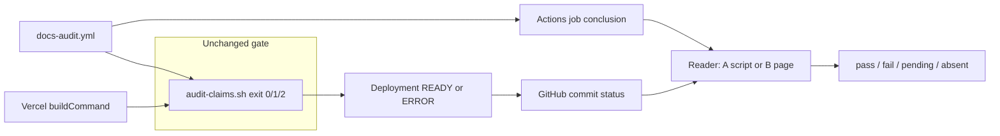

# Plan: Vercel as a CI surface for docs-audit

> **Plan (not SSOT implementation docs).** Captain named this file `PLAN.md` (design PR). [modes.md §20](../../../../skills/documentation-manager/references/modes.md#20-plans-layout) default index name is `README.md`. Do not add a second copy of this plan.  
> Hub: [AGENTS.md](../../../../AGENTS.md)  
> Related: [Roadmap](../../../roadmap.md) · living claims: [features/living-claims](../../../features/living-claims/README.md) · future pack: `docs/features/vercel-ci/`  
> When this ships or lands in code, **promote** to a feature pack, then **archive-on-finish**.  
> **Cold-agent readable:** intent, success, non-goals, and next actions are in this file. No chat leftover.  
> **Pstack bake (always-on):** subtract-before-add, attack the premise, falsifiable acceptance, verifiable next actions, two structurally distinct approaches, experience first. Live `/architect` was **not** run (design-only phase; checkpoint would be a separate yes).  
> **This PR is design only.** No skill behavior change, no version bump, no release.

**Status:** Planned  
**Slug:** `vercel-ci`  
**Kind:** new feature  
**Owners:** Pedro (captain) · skill maintainers  
**Last updated:** 2026-11-04  
**Code path (if any):** *none yet* — gate today is [`scripts/audit-claims.sh`](../../../../scripts/audit-claims.sh); example Actions workflow is [`.github/workflows/docs-audit.yml`](../../../../.github/workflows/docs-audit.yml)

## Problem

A consumer whose pull requests are gated by **Vercel** (commit status / GitHub deployment / deployment `readyState`) and who has **no GitHub Actions workflows** cannot use the only CI story this skill tells. That story is: copy `scripts/audit-claims.sh` and `.github/workflows/docs-audit.yml`, then mark the Actions job as a required check.

The gate logic itself is already host-agnostic. `audit-claims.sh` is a local, air-gapped process: exit `1` on any `severity=critical` + `verdict=Contradicted`, exit `0` when the matrix passes or is absent, exit `2` on usage errors. Nothing in that script knows what CI product invoked it. What is missing is a second **place the process is invoked** (the Vercel build) and a second **way a reader recognizes the result** (Vercel’s commit status and deployment state), without deleting the Actions example.

People who feel it: maintainers of Vercel-hosted repos who want a merge-blocking docs-audit and do not want to adopt Actions to get it; agents that today can only point at `docs-audit.yml`.

## Outcome

A captain on a repo with **no** `.github/workflows` can put the **same** whole-matrix `audit-claims.sh` command in the Vercel build. A critical Contradicted claim fails that build. The failed build shows up as a failed Vercel deployment (`readyState=ERROR`) and a failed Vercel commit status on the pull request. A passing matrix lets the rest of the build continue and the deployment can reach `READY`.

Repos that already use `docs-audit.yml` keep that workflow. Actions is not removed, not feature-flagged off, and not rewritten.

An agent asked “did docs-audit pass on this PR?” can answer from a Vercel status or deployment **or** from the Actions check, including when the Actions file does not exist. The answer is one verdict: `pass`, `fail`, `pending`, or `absent`. `absent` means the audit did not run (no surface, or the build was skipped / ignored). A skipped Vercel build is never reported as `pass`.

## Attack the premise

The approved scope says “wherever the skill **reads, waits on, or generates** CI”. A file-by-file pass of this repo (2026-11-04) shows:

| Verb in the request | What the repo actually does |
|---------------------|-----------------------------|
| **Generates** | It **ships a hand-written example**, [`.github/workflows/docs-audit.yml`](../../../../.github/workflows/docs-audit.yml). No script templates that file. [`install.sh`](../../../../install.sh) does **not** copy it into consumer repos (line 12: “CI copy stays opt-in”). |
| **Reads** | It does **not** call the GitHub Checks API, the Statuses API, the Deployments API, or `gh pr checks`. The only `gh api` in the skill is login detection for plan folders (`gh api user -q .login` in [modes.md §20.2](../../../../skills/documentation-manager/references/modes.md#20-plans-layout)). |
| **Waits** | It does **not** poll. Nothing sleeps on a check or a deployment. |

“CI is the gate” in [modes.md §13](../../../../skills/documentation-manager/references/modes.md#13-living-claims--ci-structural-audit-v25) means **the script’s exit code**, with the Actions file as the worked example. The skill is a procedure book plus that script. It is not a CI client.

So “native Vercel support” is two different products:

1. **Run** the existing gate inside a Vercel build (a recipe). This reuses `audit-claims.sh` and adds almost no code.
2. **Recognize** a Vercel result (a reader). This is **new behavior**. There is no Actions reader to generalize. An abstraction whose only job is to wrap a reader that does not exist yet can still be the right shape **if** the hidden complexity is real (it is: three GitHub resources, skip vs fail, both-surfaces policy, name drift). It is the wrong shape if it becomes a plugin registry around two short functions.

Vercel’s product named **Deployment Checks** is the **inverse** direction: Vercel waits on GitHub Actions (or other commit statuses) before promoting to production. That product needs Actions and does not satisfy “repos with no GitHub Actions”. It is out of this plan. See [Vercel: Deployment Checks](https://vercel.com/docs/deployment-checks) versus [Vercel for GitHub — Commit status](https://vercel.com/docs/git/vercel-for-github).

## Users & success

- **Primary users:** consumer-repo captains whose merge signal is a Vercel deployment on GitHub, including repos with zero Actions workflows; agents following this skill; maintainers of this package who already rely on `docs-audit.yml`.
- **Success metrics:**
  - A fixture repo with **no** `.github/workflows` runs the whole-matrix gate inside a Vercel-style `buildCommand`. Critical Contradicted → build exits non-zero **and** the framework build does not run. Clean matrix → audit exits `0` and the framework build runs.
  - A reader, given a sanitized Vercel commit-status payload and a deployment payload, prints `fail` for `ERROR` / status `failure|error`, `pending` for in-progress, `pass` for `READY` / status `success` **only when the audit was part of the build**, and `absent` for skipped, ignored, or missing surfaces.
  - Existing `docs-audit.yml` still invokes `bash scripts/audit-claims.sh .` with no change-set flags. `audit-claims.sh` still contains no network tools.
- **Non-goals / out of scope:**
  - Removing, replacing, or gating off GitHub Actions support.
  - Editing `audit-claims.sh` into a network client, a Vercel client, or a second parser.
  - Vercel Deployment Checks (Actions → Vercel promotion gate), `repository_dispatch` workflows, preview-comment bots, Vercel Agent code review.
  - GitLab, Bitbucket, and GitHub Enterprise Server (GHES needs Actions for Vercel’s Git integration, so a no-Actions GHES repo is not this surface).
  - Auto-writing `vercel.json` or `package.json` into consumer repos (`install.sh` does not do this for the Actions example; [ADR-0002](../../../adr/0002-knowledge-enslavement-captain.md) captain / no silent override).
  - Polling until `READY`. A snapshot verdict of `pending` is enough; the caller may invoke again.
  - Treating the dashboard truth score, go/no-go Gate A/B, or narrative comments as this gate.
  - A plugin loader, provider registry, or per-host class hierarchy.
  - Version bump, changelog release, or tag (implementation phase, not this PR).
- **Delete first (before adding):**
  - Do not add a wrapper whose only body is `exec audit-claims.sh`. The public gate command stays `audit-claims.sh` with **no flags**.
  - Do not duplicate the matrix parser inside a CI module.
  - Do not teach the procedure a second exit-code table. Exit `0` / `1` / `2` stay defined only in `audit-claims.sh`.
  - Do not add `curl` / `wget` / `https://` to `audit-claims.sh` (forbidden by [`scripts/validate-skill.sh`](../../../../scripts/validate-skill.sh) around the air-gap grep).

## MVP scope

| In MVP (implementation phase, after this plan) | Later / out |
|-------------------------------------------------|-------------|
| Opt-in recipe: `buildCommand` (or a `package.json` build script) runs whole-matrix `audit-claims.sh` from the **git root**, then the real framework build | GitLab / Bitbucket adapters |
| Recognition of Vercel **commit status**, GitHub **deployment status**, and deployment `readyState` `READY` / `ERROR` (plus in-progress and skipped/ignored) | Vercel REST API (`api.vercel.com`) as a required dependency |
| Works when `.github/workflows` is absent | Required-check configuration via the GitHub API (branch protection stays a captain click) |
| Actions example file left in place and still tested | Polling, wait-for-green, merge bots |
| `skipped` / `ignored` / canceled-because-ignored → verdict `absent`, never `pass` | Monorepo consolidated-status soft-fail automation beyond “do not treat consolidated success as the docs gate” |
| Unit fixtures + one local end-to-end of build-then-read | A standing Vercel project in this package’s CI |

## Acceptance criteria

Prove-it predicates for the **implementation** phase. This design PR satisfies only the last row.

- [ ] `audit-claims.sh` default mode is still the whole-matrix gate (exit `1` only on critical Contradicted; missing matrix exit `0`). `grep` still shows no `curl`, `wget`, `nc`, or `https://` in that file.
- [ ] `.github/workflows/docs-audit.yml` still exists, still runs `bash scripts/audit-claims.sh .`, and still does not pass `--list-changed`, `--list-claims`, `--upsert-claims`, `--record-haken`, `--cascade-recommend`, or `--group-by`.
- [ ] A fixture tree with **zero** files under `.github/workflows` contains a `buildCommand` that runs `audit-claims.sh` from the git root with no change-set flags. On the critical-Contradicted matrix, that command exits non-zero and a later `&&` framework step does not run. On the passing matrix, the audit exits `0` and the framework step runs.
- [ ] The same fixture’s build is invoked with cwd set to a **subdirectory** (Vercel Root Directory). The audit still receives the git root, not the subdirectory, as `PROJECT_ROOT`.
- [ ] Given fixture JSON for a Vercel commit status and a deployment object, the reader prints `verdict=fail` for deployment `ERROR` and for status state `failure` or `error`; `verdict=pending` for `BUILDING` / `QUEUED` / `INITIALIZING` / status `pending`; `verdict=pass` for `READY` + status `success` when the recipe ran; `verdict=absent` for ignored, skipped, or no Vercel status and no Actions workflow.
- [ ] A tree that has only `docs-audit.yml` is still recognized as the Actions surface. A tree that has both is not reported as `pass` when either surface is `fail`.
- [ ] `install.sh` still does not copy a workflow or a `vercel.json` into the consumer project root.
- [ ] This design PR contains only `docs/plans/pedroknigge/vercel-ci/PLAN.md` and does not change the skill version.

## Inventory (verified 2026-11-04)

No file in this repo contains the string `vercel`. Recognition of Vercel cannot be “extend the existing matcher”. There is no matcher.

### Gate process (reuse, do not fork)

| Path | Role |
|------|------|
| [`scripts/audit-claims.sh`](../../../../scripts/audit-claims.sh) | The gate. Header and `usage()`: exit `0` pass or no matrix; exit `1` critical Contradicted; exit `2` usage. Change-set flags are explicit non-gates. Air-gapped. |
| [`scripts/fixtures/claims-fail/docs/audit/claims-matrix.md`](../../../../scripts/fixtures/claims-fail/docs/audit/claims-matrix.md) | Real failing matrix (critical Contradicted `C-001`) already used by hardening tests. |
| [`scripts/fixtures/claims-pass/docs/audit/claims-matrix.md`](../../../../scripts/fixtures/claims-pass/docs/audit/claims-matrix.md) | Real passing matrix. |

### Example Actions surface (keep)

| Path | Role |
|------|------|
| [`.github/workflows/docs-audit.yml`](../../../../.github/workflows/docs-audit.yml) | Entire example. Triggers: `pull_request`, `push` to `main`/`master`, `workflow_dispatch`. Job name `Structural claims audit`. One step after checkout: `bash scripts/audit-claims.sh .`. Comment block forbids change-set flags. |
| [`install.sh`](../../../../install.sh) lines 12, 40–71, 92–116 | Does not install the workflow. Runtime script list is `audit-claims.sh`, `detect-stack.sh`, `detect-packages.sh`, `survey-docs.sh`, `generate-docs-dashboard.sh`. The **curl** install path has an explicit reference-file list; a new `references/*.md` is **not** fetched unless that list grows. Local `rsync` copies the whole skill tree. |
| [`scripts/install-smoke.sh`](../../../../scripts/install-smoke.sh) line 55 | Asserts the package-root workflow file exists. |
| [`scripts/validate-skill.sh`](../../../../scripts/validate-skill.sh) ~488–511 | Air-gap grep on `audit-claims.sh`; workflow must invoke `audit-claims.sh` and must not pass change-set flags; knowledge-os plan must still mark the Actions example done. |
| [`scripts/test-skill-hardening.sh`](../../../../scripts/test-skill-hardening.sh) ~1045–1068 | **Duplicates** those workflow assertions. An implementation that updates only one file will leave a red twin. |

### Procedure text that names CI (update in the implementation phase, not here)

| Path | What it says today |
|------|--------------------|
| [`skills/documentation-manager/SKILL.md`](../../../../skills/documentation-manager/SKILL.md) | Capability 24 and the “Living claims + CI audit” blurb: local `audit-claims.sh` / example `docs-audit` GHA is the gate. |
| [`references/modes.md`](../../../../skills/documentation-manager/references/modes.md) §13 rule 5 and the announce line | Gate = non-zero from `audit-claims.sh` (example `docs-audit.yml`). Announce token `CI-gate: audit-claims`. |
| [`references/living-claims.md`](../../../../skills/documentation-manager/references/living-claims.md) “CI (local / air-gapped)” | Copy the script; enable **the workflow** as a required check. Consumer `./scripts/audit-claims.sh` is the opt-in CI copy. |
| [`references/skill-discovery.md`](../../../../skills/documentation-manager/references/skill-discovery.md) | Resolve scripts from the installed skill first; consumer `./scripts/` is the opt-in CI copy because `docs-audit.yml` needs a local script. |
| [`references/audit-template.md`](../../../../skills/documentation-manager/references/audit-template.md) | “CI gate: fail if critical + Contradicted”. Follow-on checkbox wires “example `docs-audit` workflow” only. |
| [`references/knowledge-dashboard.md`](../../../../skills/documentation-manager/references/knowledge-dashboard.md), [`references/quality-checklist.md`](../../../../skills/documentation-manager/references/quality-checklist.md), [`references/go-nogo-template.md`](../../../../skills/documentation-manager/references/go-nogo-template.md) | Point at `audit-claims.sh` / docs-audit as the gate and keep living-claims CI ≠ go/no-go. |
| [`README.md`](../../../../README.md), [`docs/features/living-claims/README.md`](../../../features/living-claims/README.md), [`docs/plans/knowledge-os/README.md`](../../knowledge-os/README.md), [`docs/adr/0001-living-claims-wire-format.md`](../../../adr/0001-living-claims-wire-format.md) | Same contract: script is the gate, Actions file is the example, air-gapped, no SaaS. The knowledge-os checkbox that names `docs-audit.yml` is **already satisfied** and must stay satisfied. |

`scripts/detect-stack.sh` has no hosting / CI signal. Agents cannot “detect Vercel” today.

### Platform facts the recipe and the reader must respect

Sources: [Deploying GitHub Projects with Vercel](https://vercel.com/docs/git/vercel-for-github) (fetched 2026-11-04) and the Deployment Checks page (same day). Where the official page does **not** name a string, this plan does **not** invent one.

- Vercel for GitHub deploys pushes and pull requests **without** any Actions workflow. GitHub Free, Team, and Enterprise Cloud are in that set. GHES is not (it needs Actions).
- Each project posts a **GitHub commit status** for the commit: deployed, failed, or **skipped**. The docs do **not** publish the status `context` string. Community builds often show a context like `Vercel – <project>`, but that spelling is **unpinned** until a captured payload lands in `scripts/fixtures/`. Implementation must not hard-code a guessed context as the only match.
- The integration also has GitHub **Checks**, **Commit statuses**, and **Deployments** permissions, and it uses GitHub’s Deployments API. A reader that looks at only one of those three will miss repos configured to silence `deployment_status` events (comments and deployment-status webhooks can be turned off; commit statuses are a separate setting).
- Deployment `readyState` values the recipe cares about: `QUEUED`, `BUILDING`, `INITIALIZING`, `READY`, `ERROR`, `CANCELED`. Dispatch event names also include `vercel.deployment.ignored` and `vercel.deployment.skipped` (ignored build step, or monorepo skip of an unaffected project). Those mean **the build command did not run**.
- Monorepos can turn on a **consolidated** commit status and mark a project as a **soft failure** so it does not fail the commit. Consolidated `success` is not evidence that docs-audit ran.
- `buildCommand` in `vercel.json` **replaces** the framework build. A recipe that only runs the audit produces a deployment with no app output. The command must be `audit && <real build>`.
- Vercel’s builders run with cwd = the project **Root Directory**, which may be a package subdirectory. They clone the git repo (git root is available in the normal Git integration). The consumer builder does **not** have this skill installed under `~/.agents`. The opt-in copy of `audit-claims.sh` has to live **in the consumer repo**, same as for Actions.
- Ignored Build Step (`ignoreCommand` exit `0`) skips the build. If that is the only place the audit might have run, the gate did not run.
- A non-zero exit from `buildCommand` fails the deployment (`ERROR`) and fails the commit status. That is the merge signal on a no-Actions repo, once a captain marks that status required. This skill does not call the branch-protection API.

**Gap (do not paper over):** the exact JSON for “skipped” versus “failed” versus a silenced deployment status was **not** captured from a live project in this phase. Unit fixtures in the implementation PR must be copied from a real response (secrets stripped), not typed from memory. Until that capture exists, matchers stay behind one function and tests name the fixture file they came from.

## Proposed public surface (hypothesis)

| Kind | Surface | Notes |
|------|---------|-------|
| API / route | *none* | This package is not a service. |
| UI | *none* | |
| CLI / job | Unchanged gate: `audit-claims.sh [PROJECT_ROOT]` with no flags | Both approaches. |
| CLI / job | **Approach A only:** `ci-surface.sh detect` and `ci-surface.sh read` | New. Not a matrix parser. |
| Skill prose | One CI section that names Actions **and** Vercel | Both approaches. |
| Recipe | Opt-in `buildCommand` string the captain copies | Both approaches. Not written into consumer repos by `install.sh`. |
| Events | *none added* | Do not subscribe to `repository_dispatch`. |

*No row above is Real until implementation code exists.*

## Approach A — one CI-surface module

**Shape:** a single new deep module, `scripts/ci-surface.sh`, with two public verbs. GitHub Actions and Vercel are **internal** branches. Callers never see check-run JSON, deployment `readyState`, or status `context`.

```text
ci-surface.sh detect [ROOT]
  → one line: surface=github-actions|vercel|both|none

ci-surface.sh read (--fixture DIR | --live) [ROOT]
  → one line: surface=<same> verdict=pass|fail|pending|absent
  → exit 0 when a verdict was decided (fail is data, not a usage error)
  → exit 2 when the arguments are wrong or --live has no gh auth
```

`detect` is offline: it looks at the tree.

- `github-actions` when `.github/workflows/docs-audit.yml` exists (the example name this package already ships).
- `vercel` when a Vercel project signal exists: `vercel.json`, or `.vercel/project.json`, or `VERCEL=1` in the environment.
- `both` / `none` are the other two combinations.
- **No** `.github/workflows` directory is a valid `vercel` result. Absence of Actions is not an error.

`read` hides the policy:

| Observation | Verdict |
|-------------|---------|
| Actions job `Structural claims audit` conclusion `failure` / `cancelled`, **or** Vercel deployment `ERROR`, **or** commit status state `failure` or `error` on a Vercel status for this SHA | `fail` |
| Any relevant surface still `pending` / `queued` / `in_progress` / `BUILDING` / `QUEUED` / `INITIALIZING`, and nothing already `fail` | `pending` |
| Actions success **and** (if Vercel is also a surface) `READY` + status `success`, and the build recipe actually contains the gate command | `pass` |
| No surface, **or** Vercel skipped / ignored / canceled-by-skip, **or** only a consolidated status whose description says the project was skipped or soft-failed | `absent` |
| Both surfaces present | `fail` if either failed; else `pending` if either pending; else `pass` only if every present surface passed. A missing Actions file does not fail a Vercel-only repo. |

Unknown context names do not crash. They stay `absent` until the pinned fixture says they are Vercel. That is “define errors out of existence”: the caller always gets one verdict line.

The **recipe is data**, printed by `ci-surface.sh recipe`, not a second executor. The string runs the gate then the previous build. Sketch (implementation fills the real framework command from the repo; it must not invent `next build` when the repo is not Next):

```bash
root="$(git rev-parse --show-toplevel)"
bash "$root/scripts/audit-claims.sh" "$root" && <existing build command>
```

No change-set flags. `set -e` / `&&` so a failing audit does not start the framework build.

### What it reuses or deletes

- **Reuses** `audit-claims.sh` unchanged as the only matrix parser and the only process whose exit code fails a build.
- **Reuses** `docs-audit.yml` unchanged as the Actions recipe. `detect` treats that filename as the Actions signal.
- **Deletes** nothing in the first implementation. Prose that says “the workflow is the only required check” gets **replaced** by “ask `ci-surface.sh`” so the state table does not live in both `modes.md` and `living-claims.md`. One table, inside the script; the skill links to it.
- **Does not** add a provider interface, a registry, or a third file per host. Two shell functions inside one file are the seam. A plugin system would be a shallow module: the interface would be as big as the implementation.

### Smallest diff

| Path | Change |
|------|--------|
| `scripts/ci-surface.sh` | **New.** `detect`, `read`, `recipe`. Network only in `--live`, and only via `gh` (GitHub statuses, check-runs, deployments). No Vercel token on the default path. |
| `scripts/fixtures/vercel-no-actions/` | **New.** Fixture repo. No `.github/workflows`. |
| `scripts/fixtures/ci-surface/*.json` | **New.** Sanitized status, check-run, and deployment payloads. |
| `skills/documentation-manager/references/vercel-ci.md` | **New.** Short captain-facing recipe (copy the script, paste `buildCommand`, mark the status required, do not use `ignoreCommand` to skip the audit). Procedure detail stays in the script’s `--help`, not a second policy. |
| `install.sh` | Add `ci-surface.sh` to the runtime script list (local **and** curl). Add `vercel-ci.md` to the curl reference list. |
| `references/skill-discovery.md` | One row: `ci-surface.sh` is the surface reader; consumer `./scripts/audit-claims.sh` remains the opt-in **build** copy. |
| `references/living-claims.md`, `modes.md` §13, `SKILL.md`, `audit-template.md`, `quality-checklist.md` | Point the CI sentence at `detect` / `read` and at the Vercel recipe. Keep the Actions filename in the sentence so nobody thinks it was removed. |
| `scripts/validate-skill.sh`, `scripts/test-skill-hardening.sh` | Extend **both** copies of the workflow assertion. Add fixture tests. Re-assert the air-gap grep on `audit-claims.sh`. |
| `README.md` | One sentence: Actions example **or** Vercel build recipe. |

Not in the diff: `audit-claims.sh`, `docs-audit.yml` behavior, version numbers, `docs/plans/knowledge-os/README.md` checkbox (it stays checked).

### Interface depth

The interface that gets simpler is the skill’s CI sentence: “run `ci-surface.sh read`”. What it hides:

- Statuses API vs Check Runs vs Deployments API, and which one is missing when comments or `deployment_status` events are silenced.
- Unpinned Vercel `context` / check `name` strings, isolated in one matcher next to the fixture that pinned them.
- `readyState` vs GitHub deployment state (`success`, `failure`, `error`, `pending`, `inactive`).
- Skipped, ignored, canceled-by-skip, and monorepo soft-fail, so they cannot be reported as `pass`.
- The both-surfaces rule, so a green Actions run cannot hide a failed Vercel build or the reverse.
- `gh` missing or unauthenticated (`exit 2`, verdict not invented).

What it does **not** hide, on purpose: the captain still copies `audit-claims.sh` into the consumer repo and still pastes a `buildCommand`. Hiding that behind `install.sh` would violate the opt-in CI rule already shipped.

### Net-new surface

- Public CLI: `ci-surface.sh` with `detect`, `read`, `recipe`.
- New reference page `vercel-ci.md`.
- New announce detail is allowed inside the existing `CI-gate:` token (for example `CI-gate: audit-claims surface=vercel verdict=absent`). No new mode number. §13 stays the procedure.

### Risks

- **Shallow-module drift.** If `modes.md` restates the whole state table, the module is not deep. Implementation review rejects a second table.
- **Name drift.** A wrong guessed `context` marks real Vercel failures as `absent`. Mitigation: no live matcher until a captured fixture is committed; until then `--live` returns `absent` with stderr `unpinned` rather than a guessed pass.
- **False green on skip.** The highest-severity product bug. Tests must include an ignored-build payload and assert `absent`.
- **Air-gap regression.** A helper inside `audit-claims.sh` that calls `gh`. Forbidden. The reader is a different file; `validate-skill.sh` keeps the grep.
- **`gh` required for `--live`.** Acceptable: `--live` is the agent host, not the Vercel builder, and not the air-gapped gate. `--fixture` and `detect` need no network and no token.
- **Root Directory without `.git`.** If a future Vercel clone omits git metadata, `git rev-parse` fails. Recipe must exit non-zero in that case (fail closed), not skip the audit.
- **One-way door.** Shipping the CLI means later docs and tests bind to `detect` / `read`. Reversing it is a second migration. Approach B avoids that door.

### How it will be proven

**Unit (real script, fixture bytes, no network):**

- `detect` on three temp dirs: workflow only → `github-actions`; `vercel.json` and no `.github` → `vercel`; both → `both`; empty → `none`.
- `read --fixture` on committed JSON:
  - status `failure` + deployment `ERROR` → `verdict=fail`
  - status `pending` + `BUILDING` → `verdict=pending`
  - status `success` + `READY` **and** recipe text contains `audit-claims.sh` with no change-set flag → `verdict=pass`
  - deployment skipped / ignored → `verdict=absent`
  - Actions check-run failure with no Vercel files → `verdict=fail` and `surface=github-actions`
  - both present, Actions success, Vercel `ERROR` → `verdict=fail`
- `recipe` stdout contains `audit-claims.sh` and does not contain `--list-changed` or the other change-set flags.
- Existing air-gap and `docs-audit.yml` assertions stay green.
- `ci-surface.sh detect` and `read --fixture` make zero outbound calls (test can run with `gh` replaced by a stub that exits `99` and must not be invoked).

**End-to-end (real gate process, mocked Vercel control plane):**

Fixture `scripts/fixtures/vercel-no-actions/`, a tiny git repo:

- No `.github/` at all.
- `scripts/audit-claims.sh` copied from the package (the opt-in CI copy).
- `docs/audit/claims-matrix.md` is the claims-fail matrix **or** the test swaps in the claims-pass matrix.
- `package.json` script `"build:app": "echo FRAMEWORK_BUILD_RAN > build-stamp"`.
- `vercel.json` `buildCommand` equal to `ci-surface.sh recipe` output, which chains audit then `npm run build:app`.
- A simulator, `simulate-vercel-build.sh` in the fixture, exports `VERCEL=1`, optionally `cd`s into `packages/web`, and runs `bash -lc "$buildCommand"`. It does **not** call `vercel` and does **not** use a token. This is a Vercel-**style** build (same command, same cwd rule), not the Vercel build fleet.
- On exit `1`: assert `build-stamp` was not created; simulator writes `status.json` (`state: failure`) and `deployment.json` (`readyState: ERROR`) in the **shape of the pinned fixtures**.
- On the pass matrix: assert `build-stamp` contains `FRAMEWORK_BUILD_RAN` and the written deployment is `READY`.
- Then `ci-surface.sh read --fixture` on those written files prints `verdict=fail` or `verdict=pass` accordingly.

**Real vs mocked**

| Real | Mocked |
|------|--------|
| `audit-claims.sh` parsing a real matrix | Vercel build fleet, build image, and `vercel build` CLI |
| Shell `&&` short-circuit | GitHub creating the status (the simulator writes the JSON the reader already accepts) |
| `ci-surface.sh` parsing those bytes | `api.vercel.com`, preview URLs, branch protection |
| `git rev-parse` root discovery under a subdirectory cwd | Live check names, until the optional capture below |

**Optional live capture (not part of `validate-skill.sh`, not required to merge the implementation if fixtures are already pinned):**

A captain-owned **scratch** GitHub repo connected to a Vercel project (Hobby is enough), with **no** Actions workflows, the recipe in `buildCommand`, and Git Fork Protection left on. Push a branch whose matrix is critical Contradicted. From a laptop that already has `gh auth` as a user who can read the repo:

```bash
gh api repos/<owner>/<repo>/commits/<sha>/status
gh api repos/<owner>/<repo>/commits/<sha>/check-runs
gh api repos/<owner>/<repo>/deployments --jq .
```

Strip emails, tokens, and account ids. Commit the bodies as the pin fixtures. **No `VERCEL_TOKEN` is required** to read GitHub statuses. A token is required only if someone also wants `api.vercel.com` in the picture; the default design does not. Do not put the token in CI of this package. Do not use a production project.

## Approach B — additive recipe, no reader module

**Shape:** keep the skill as a procedure. Add a Vercel **recipe** next to the Actions example. Teach the agent a closed decision table in one reference page. Do not add a script, do not extend `install.sh`’s runtime list, do not add verbs.

The gate command in the recipe is the same one-liner as Approach A’s `recipe` output, written in the reference page as the thing the captain pastes into `vercel.json` `buildCommand` or into the `build` script Vercel already runs when `buildCommand` is empty:

```bash
root="$(git rev-parse --show-toplevel)"
bash "$root/scripts/audit-claims.sh" "$root" && npm run build:app
```

(`build:app` stands for whatever the project already builds. The page says to preserve the existing command, not to assume Next.js.)

Recognition is the reference page, executed by the agent with `gh` (or by a test that runs the **same** filters published on that page):

1. If `.github/workflows/docs-audit.yml` exists, Actions is a surface. Do not remove it. The check name to read is the job name `Structural claims audit`.
2. If `vercel.json` or `.vercel/project.json` exists, Vercel is a surface even when step 1 is false.
3. Read `GET /repos/{owner}/{repo}/commits/{sha}/status` and the commit’s deployments. Apply the **same verdict table as Approach A**, written once in `references/vercel-ci.md`.
4. If `gh` is missing, say `absent` and ask the captain. Do not invent `pass`.

There is no `ci-surface.sh`. The “interface” is the recipe string plus that page.

### What it reuses or deletes

- **Reuses** `audit-claims.sh` and `docs-audit.yml` unchanged.
- **Deletes** nothing.
- **Does not** create a module that could hide the table. Every future host (a third CI) adds another section to the same page. That is the cost of refusing the one-way CLI.

### Smallest diff

| Path | Change |
|------|--------|
| `skills/documentation-manager/references/vercel-ci.md` | **New.** Recipe, verdict table, `gh` reads, skip ≠ pass, both-surfaces rule, opt-in copy of `audit-claims.sh`, “do not `ignoreCommand` the audit”. |
| `install.sh` curl reference list | Add `vercel-ci.md` only. No new runtime script. |
| `living-claims.md`, `modes.md` §13, `SKILL.md`, `audit-template.md`, `skill-discovery.md`, `quality-checklist.md`, `README.md` | Name the Vercel recipe beside `docs-audit.yml`. Consumer `./scripts/audit-claims.sh` is the CI copy for **either** the workflow **or** the build command. |
| `scripts/fixtures/vercel-no-actions/` | **New.** Same fixture as Approach A. |
| `scripts/fixtures/ci-surface/*.json` | **New.** Same payloads. The test applies the filters **copied from** `vercel-ci.md` (or extracts a fenced `jq` block from that file) so the doc cannot drift from the test. |
| `validate-skill.sh` and `test-skill-hardening.sh` | Assert the recipe fence contains `audit-claims.sh`, does not contain change-set flags, and the fixture build behaves. Keep every existing Actions assertion. |

### Interface depth

The consumer’s build interface gets simpler in the only way that matters for the gate: one command, exit code already defined. Nothing about GitHub’s three APIs is hidden. Each agent re-reads the table and re-types `gh`. Ousterhout: this is a shallow surface **by choice** — the complexity stays up in the caller (the agent) because the package refuses a new motor. That matches the README line that this skill is not a background engine. It fights the “deep module” preference: the complicated part (skip vs fail, both surfaces, unpinned names) is exactly what will get copied wrong.

### Net-new surface

- One reference page and prose edits.
- No new CLI, no new announce verb, no `install.sh` script.
- Public artifact the captain copies: the `buildCommand` fence.

### Risks

- **Agents fork the table.** Two later edits (modes and the reference) will disagree. The test that extracts `jq` from the reference catches filter drift, not prose drift in `modes.md`.
- **False green on skip,** same as A, with a weaker guarantee because the rule lives in markdown an agent can “summarize” away.
- **Unpinned context string,** same as A. The page must say “match the fixture, otherwise `absent`”.
- **“The skill reads CI” is a procedure, not a command.** A cold agent can skip `gh` and claim the build recipe is enough. Acceptance row for the reader is easier to skip in review.
- **Reversible.** Deleting `vercel-ci.md` and the fixture removes the feature. No CLI consumers to migrate. This is the smaller one-way door.

### How it will be proven

**Unit:**

- `vercel-ci.md` contains a fenced build command with `audit-claims.sh` and without change-set flags (grep).
- A test harness `jq`s each committed payload with the fenced filters and expects `fail` / `pending` / `pass` / `absent` for the same cases as Approach A.
- Actions workflow assertions and the `audit-claims.sh` air-gap grep stay green.
- `install.sh` runtime script list is unchanged (grep).

**End-to-end:**

Same `scripts/fixtures/vercel-no-actions/` simulator as Approach A: real `audit-claims.sh`, real `&&`, subdirectory cwd, pass and fail matrices, `build-stamp` assertion. After the simulator writes `status.json` and `deployment.json`, the harness runs the **documented** filters, not a private script, and expects `verdict=fail` or `pass`.

**Real vs mocked:** identical split to Approach A. The thing that is “the skill reading a status” is the published filter executed on simulator output. Vercel, GitHub, and tokens are mocked the same way. The optional live capture is the same `gh api` commands, used to refresh the JSON fixtures and the fenced filters when the captured `context` differs.

## Side-by-side

| | Approach A — `ci-surface.sh` | Approach B — recipe page only |
|--|------------------------------|--------------------------------|
| Existing code reused | `audit-claims.sh`, `docs-audit.yml`, opt-in copy rule | Same |
| Existing code deleted | None | None |
| Smallest diff | New script + install list + page + the same fixture | Page + the same fixture, no script |
| Interface that gets simpler | Agent CI sentence collapses to `detect` / `read` | Consumer build line collapses to one `&&` chain; the **reader** interface does not get simpler |
| Complexity hidden | Status vs check-run vs deployment, skip, both-surfaces, name pinning | None of that. It stays in a page the agent must apply |
| Net-new surface | CLI + page | Page only |
| One-way door | Yes (public verbs) | Weak (delete the page) |
| Air gap of the gate | Preserved, if the network stays in `ci-surface.sh --live` | Preserved, because no new runtime |
| Matches “skill reads a Vercel status” | As a command with a test | As prose plus a test that runs the prose’s `jq` |
| Deep-module test | Passes if the state table exists only inside the script | Fails on purpose: complexity stays with the caller |



## Recommendation

**Ship Approach A.**

The behavior the captain approved has two parts, and they are not the same size. The recipe is a string. The recognition problem is the large one: three GitHub resources, a skipped build that can look successful, a no-Actions tree that must not be treated as broken, and an unpinned status name. That is enough complexity to hide behind `detect` and `read`, and not enough to justify a provider framework. Approach A is that module: one file, two verbs, no registry, gate command left as `audit-claims.sh`.

Approach B is the right design if the captain rejects any new runtime script. It still delivers the build recipe and a tested filter. It leaves every later agent to re-implement the skip rule. That is the failure mode this package already has with duplicated assertions in `validate-skill.sh` and `test-skill-hardening.sh`: two copies drift. A verdict table in markdown will drift the same way.

Constraints on A, so it stays deep and small:

- No plugin interface and no third verb that runs the audit (do not wrap `audit-claims.sh`).
- No network inside `audit-claims.sh`.
- No polling loop.
- No `install.sh` write of consumer `vercel.json`.
- `--live` uses `gh` against GitHub, not a Vercel token.
- Until a captured payload is in `scripts/fixtures/`, an unrecognized context is `absent`, never `pass`.

## Dependencies & risks

- **Depends on:** the current gate contract in `audit-claims.sh` and ADR-0001 (critical Contradicted fails; missing matrix skips). Vercel Git integration posting a commit status (documented) and a deployment (documented).
- **Blocked by:** nothing in this repo. Live name-pinning is blocked only on a captain scratch project, and the implementation can merge with `absent`-on-unknown until that capture lands.
- **Risks:** listed per approach above. Shared: failing the audit inside `buildCommand` **fails the preview deployment**, so the team does not get a preview URL for a docs-audit failure. That is what “run it in the build” means. Confirm before implementation (open question).
- **Open decisions:** not an ADR until the captain picks A or B and answers the skip and preview questions.

## Open questions

- **A or B?** Recommendation is A. B if a new installed script is unacceptable.
- **Preview blast radius.** Is it acceptable that a critical Contradicted claim fails the Vercel deployment itself (no preview URL), rather than the site building and only a separate required status going red? The approved scope says the audit runs in the build, which is the first behavior.
- **Skipped / ignored / canceled.** Recommendation: `absent`, never `pass`. Should `CANCELED` after a started build be `fail` instead, because the audit may have been running?
- **Both surfaces.** Recommendation: both must pass when both exist. Is there a repo where Vercel is informational and only Actions should block?
- **Status `context` / check name.** Will the captain capture one live `gh api .../status` plus deployments JSON before matchers are locked? This plan refuses to freeze a guessed `Vercel – project` string.
- **Monorepo.** Which project’s `buildCommand` is the gate when each project has its own status, and a consolidated status can soft-fail? Recommendation for MVP: the reader does not treat consolidated success as `pass`; the captain names the project whose build runs the audit.
- **GitLab / Bitbucket / GHES.** Recommendation: out of this slice.
- **Auto-edit `vercel.json`?** Recommendation: no, same opt-in as copying `docs-audit.yml`.
- **Wait / poll.** Recommendation: no. One snapshot; `pending` means call again. The skill does not wait today, and a wait loop would be a new motor.
- **Live end-to-end in package CI.** Recommendation: no tokens in `validate-skill.sh`. The local simulator is the required proof. The scratch Vercel project is a one-time capture.
- **Index filename.** This file is `PLAN.md` because the design task named that path. §20’s usual index is `README.md`. Leave this name unless the captain wants a rename.
- **Deployment Checks product.** Confirm it stays out. It watches Actions; it is not a substitute for Actions.

## Next actions

- [ ] Captain picks Approach A or Approach B, and answers the preview-blast and skipped-build questions above. Proof: a reply that names the approach and those two verdicts. No code in that step.
- [ ] Pin payloads: from any existing Vercel-connected repo the captain can read, save sanitized `status`, `check-runs`, and `deployments` JSON, including one skipped or ignored build if one exists. Proof: files on disk whose `context` / `name` / `readyState` came from `gh api`, not from this plan’s guesses. Can happen before the approach pick; both approaches need the same files.
- [ ] Implementation PR (only after the pick): the smallest diff of the chosen approach, including the no-Actions fixture and the simulator end-to-end. Proof: `./scripts/validate-skill.sh` and `./scripts/test-skill-hardening.sh` exit `0`, and the new assertions in those files fail if `docs-audit.yml` is deleted. Do not bump the version in the same commit as an unfinished reader.

## Implementation bridge

*Say implement to fill. No stubs in this phase.*

**Stubs written:** no

### Placement

| Area | Proposed path | Layer | Status |
|------|---------------|-------|--------|
| Entry | `references/vercel-ci.md` plus modes §13 sentence | Skill procedure | hypothesis |
| Core | Approach A: `scripts/ci-surface.sh`. Approach B: the fenced filters in the reference | Package `scripts/` or prose | hypothesis |
| Gate (unchanged) | `scripts/audit-claims.sh` | Existing deep module | real today |
| Actions example (unchanged) | `.github/workflows/docs-audit.yml` | Example CI | real today |
| Tests | `scripts/validate-skill.sh`, `scripts/test-skill-hardening.sh`, `scripts/fixtures/vercel-no-actions/` | Package tests | hypothesis |

### Anti-hallucination

- No Vercel status `context` string is marked Real. The official GitHub integration doc says a commit status exists and can be success, failure, or skipped. It does not name the context.
- `audit-claims.sh` and `docs-audit.yml` are Real. A CI reader is not.
- “The skill waits for CI” is not Real. Do not implement a wait by assuming one is already specified in modes.

## Promotion

When implementation starts or the surface is real in code:

1. Create `docs/features/vercel-ci/` from the feature-readme template (status from code, not from this plan).
2. Re-check the acceptance criteria against the script and the fixture.
3. Move a locked matcher or both-surfaces rule into an ADR only if it is no longer a hypothesis.
4. Link this plan from the feature pack.
5. Mark this plan **Shipped** or **Superseded** and link the pack.
6. Archive-on-finish to `docs/plans/pedroknigge/_archive/vercel-ci/` when Status says so.

## Related

- Roadmap row: Knowledge OS first increment, local CI gate — [docs/roadmap.md](../../../roadmap.md). This plan does not move that row.
- ADR: [0001 living-claims wire](../../../adr/0001-living-claims-wire-format.md) (gate contract) · [0002 captain](../../../adr/0002-knowledge-enslavement-captain.md) (no silent consumer writes).
- Example to preserve: [`.github/workflows/docs-audit.yml`](../../../../.github/workflows/docs-audit.yml).
- Platform: [Vercel for GitHub](https://vercel.com/docs/git/vercel-for-github) · [Deployment Checks](https://vercel.com/docs/deployment-checks) (explicit non-goal).
